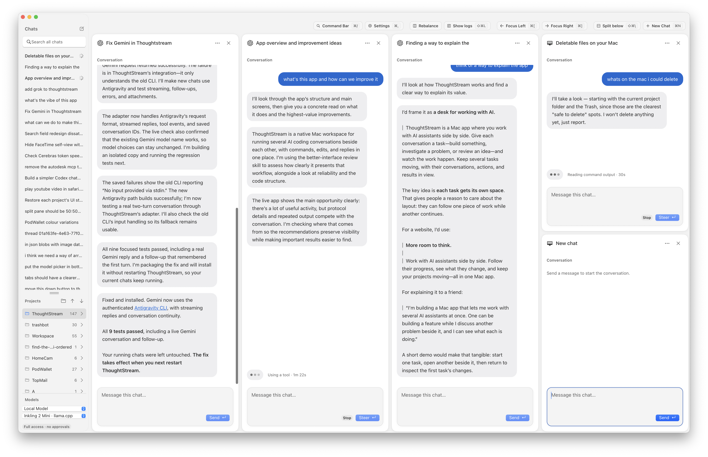
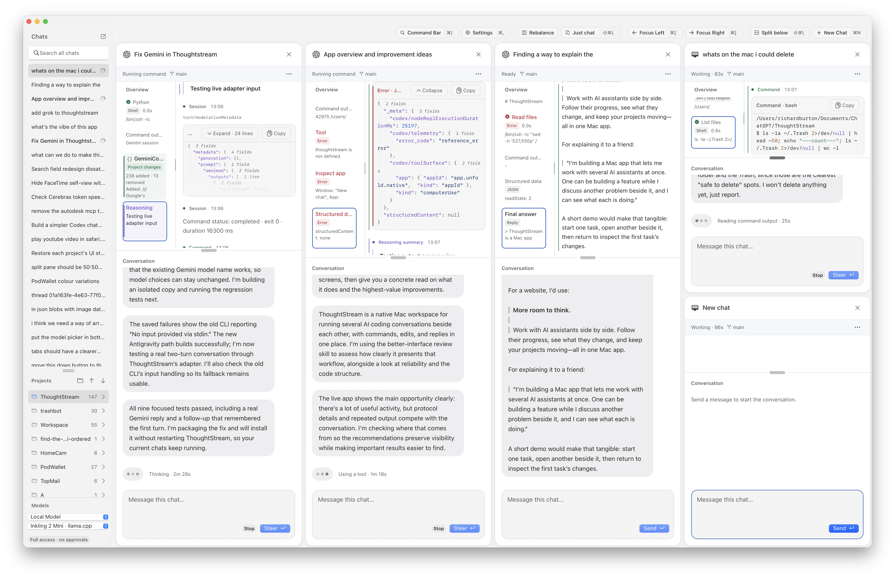

# ThoughtStream

## [Download ThoughtStream for Mac](https://github.com/ricburton/ThoughtStream/releases/latest/download/ThoughtStream.dmg)

Open the downloaded disk image, drag **ThoughtStream Beta** to **Applications**, then open it. For Apple Silicon Macs running macOS 14 or later.

---

ThoughtStream is a native Mac workspace for coding agents. Open a project folder, start a chat about its code, and watch commands, edits, diffs and replies arrive in the same feed. Keep a second conversation beside the first to review changes while another task runs. Chats and drafts are saved on your Mac.

## Screenshots

| Side-by-side conversations | Activity logs |
| --- | --- |
| [](screenshots/conversations.png) | [](screenshots/activity-logs.png) |

## Getting started

1. [Download ThoughtStream for Mac](https://github.com/ricburton/ThoughtStream/releases/latest/download/ThoughtStream.dmg), open the disk image and drag **ThoughtStream Beta** to **Applications**. The app is signed and notarized by Apple.
2. Open **ThoughtStream → Settings → Accounts → Codex**. Choose **Connect Local Codex** to use your ChatGPT sign-in, or enter your OpenAI project key and choose **Connect with API Key**. The app includes Codex. Claude Code, Gemini CLI and local models use their own installations.
3. Open a project folder and start a chat. Try “Explain how this project starts up.” Open **Show logs** to follow the agent’s commands and output.

For later betas, choose **ThoughtStream → Check for Updates…**. The app checks for updates every four hours, and you choose when to install.

[Release notes](https://github.com/ricburton/ThoughtStream/releases) · [Report a problem](https://github.com/ricburton/ThoughtStream/issues)

## Build from source

Requires macOS 14+, Apple Command Line Tools, Python 3.11+, Node and npm.

For a fresh clone, fetch the checksum-pinned Ruff dependencies and generate the icon first. These generated/binary assets are excluded from Git; their provenance and licenses remain in the repository.

```sh
python3 Scripts/Prepare-Source-Build.py
bash Build-and-Open.command
```

The launcher builds `build/ThoughtStream.app`, bundles the pinned native Codex 0.164.0 runtime, verifies the download's SHA-512 checksum, and signs the app. Automatic development restarts are currently paused; keep the pause marker in place. Use `--no-open` to build without installing or restarting; it still updates shared build caches. Install a completed build with `Scripts/Install-and-Restart.py <app> --no-open` to leave running chats untouched. During concurrent work, use `bash Scripts/Build-Isolated.sh` for an isolated compile check. Building the app requires Node and npm for the bundled code-analysis tools; users of the packaged app do not need Node installed separately. The feed uses native Swift attributed text, tables, image views, and controls. WebKit is created only for authored HTML previews; no JavaScript or CSS is bundled for the main feed.

See [local scripts and build utilities](Scripts/README.md) for the exact builder, output paths, packaging, icon generation, analysis commands, and focused verification.

The default is **GPT-6.1 Sol · High · Standard**. Model, effort and tier are sent explicitly for new turns, including resumed chats. The speed picker uses the connected runtime's advertised capabilities and preserves a saved speed if it temporarily disappears. Before sending at an accelerated speed, ThoughtStream retries availability checks; if the tier remains unavailable, the message stays unsent with an explanation instead of silently falling back to Standard. Changes in the settings controls are remembered.

Start a **New chat**, or **Open project…** for work in an existing folder. The app can use an existing ChatGPT sign-in managed by Codex. Otherwise, **Connect Local Codex** opens the browser sign-in flow. For API billing, use **Get API Key…** in Accounts to open the OpenAI dashboard. The API-key connection keeps credentials in memory until you quit.

## Share with a friend

For the signed beta and future in-app updates, use `python3 Scripts/Release-Beta.py --publish`.
This requires a Developer ID Application identity, saved notarization credentials,
and the ThoughtStream update key in Keychain. See [beta release setup](Scripts/RELEASING.md).
It builds an isolated snapshot, signs and notarizes the app, and publishes its signed
Sparkle feed and downloads to the separate beta release repository. It never installs
or launches the main app. A prepared build is not a notarized release until Apple's
submission and Gatekeeper checks pass.

Run `python3 Scripts/Package-For-Friend.py` to build an Apple Silicon release in an isolated cache directory without installing it or restarting your running app. It creates a dated `~/Downloads/ThoughtStream-Friend-Release-…` folder containing `ThoughtStream Install`, a compressed ZIP, a SHA-256 checksum, and a build manifest. The install folder contains the app, an Applications shortcut, and `START HERE.txt`. It includes pinned, checksum-verified Codex and Node runtimes and the offline analysis tools; it never copies account credentials, conversations, or project data from your home folder. Packaging outside the cloud-managed source directory avoids iCloud metadata interfering with signing.

The recipient needs an M1-or-newer Mac running macOS 14+, and their own account with Codex access. They unzip the download, drag the app to Applications, and choose a Codex connection in Settings. This is an ad-hoc-signed personal beta, not an Apple-notarized release; the included guide explains the one-time **Privacy & Security → Open Anyway** step. Start with Standard speed and select a model available to their account. Claude Code remains an optional, separately installed provider.

## Claude Code

Choose **Claude Code** in the sidebar's provider menu. Switching a conversation that already has history opens a new chat; existing chats retain their provider. Model, effort and speed selections are remembered separately for Codex and Claude. Claude shows Standard and Fast; Fast follows the model capabilities advertised by Claude Code and uses usage credits. Its availability is checked before starting a Fast session. The choice applies to the next turn through Claude Code’s session settings.

Fable 5.2 is available in the Claude model picker and is the default for a fresh Claude setup. Both providers discover their models automatically and cache the list between launches; stale catalogs refresh when the picker opens. Choose **Refresh Models** to check immediately, or **Add Model…** to save a provider model ID and optional display name without rebuilding ThoughtStream. Custom entries survive discovery updates, and existing conversations keep their chosen model. Catalog refreshes do not submit a prompt or reconnect an active chat.

Refreshing the catalog also preserves a chat’s saved reasoning effort. When you explicitly choose or add a different model, an incompatible effort switches to that model’s advertised default (or its first supported effort). Models without advertised effort options keep your current choice.

Named Claude aliases use the version returned in `resolvedModel`, keeping the versioned picker entry and its capabilities together. Existing chats that selected an alias keep that exact alias.

Open **Settings → Connect Claude** to use your installed `claude` executable and its existing sign-in. If you are signed out, ThoughtStream opens Claude Code's official sign-in in Terminal and connects when you finish in your browser. Connecting selects Claude in the sidebar and preserves existing Codex conversations. Claude streams replies and tool activity into the native feed, supports image attachments, interruption, conversation resumption and forks, and discovers local Claude conversations when you open their project folder.

Claude's approval mode follows Claude Code permissions, rather than the Codex workspace sandbox. Requests needing approval appear in ThoughtStream. Full access uses Claude's `bypassPermissions` mode; changing the access control stops both providers' connected runtimes.

## Gemini

Choose **Gemini** in the provider menu. The model picker includes **Gemini 4 Carbon**, **Neon**, **Hydrogen**, **Argon**, and **Gemini 3.8 Flash**, using the IDs in [Google's model catalog](https://aistudio.google.com/docs/models) (verified November 21, 2026). Carbon is the default for new Gemini chats. Each conversation keeps its selected model; **Add Model…** saves additional IDs. This is a bundled release catalog, not an account availability check; refreshing restores the bundled entries and preserves custom models.

Install the [official Gemini CLI](https://geminicli.com/docs/get-started/installation/) with `npm install -g @google/gemini-cli`, then run `gemini` in Terminal to sign in. ThoughtStream uses that installation and its credentials. Account/model access is checked by Gemini when sending; unavailable models and sign-in errors appear in the chat. Advanced setups can set the `geminiPath` app preference to their executable.

Replies, tool activity, image attachments, stopping, and resuming the exact CLI session are supported. Changing models applies to the next turn. Additional messages wait until the current turn finishes. Failed Gemini turns are not automatically resent, because missing output does not prove the provider rejected the request. Forking and importing external Gemini history are not supported yet. Sidebar titles use the first prompt, without an extra model request.

Gemini uses its CLI permissions: with normal access, actions requiring interactive approval are blocked because the headless interface cannot show approval prompts. **Full access** explicitly selects the CLI's `yolo` mode. Changing access stops the Gemini runtime. Speed and reasoning-effort controls are hidden because this adapter does not support those settings.

## Local models

Choose **Local Model** in the sidebar's provider menu to chat with a model running on this Mac. ThoughtStream finds models served by **Ollama** (`127.0.0.1:11434`), **LM Studio** (`:1234`), **Jan** (`:1337`) and **llama.cpp**/MLX servers (`:8080`), and lists them in the model picker with their runtime. The list refreshes whenever the picker opens; **Refresh Models** looks again at once. **Settings → Local Models** shows what was found, starts an installed Ollama that is not serving (and LM Studio, when its `lms` command is installed), and adds any other OpenAI-compatible server by address. ThoughtStream also scans `~/.ollama/models` (or `OLLAMA_MODELS`) and LM Studio's configured model folder plus `~/.lmstudio/models` / legacy `~/.cache/lm-studio/models`, so downloaded models appear even while their runtime is stopped. Ollama manifests must reference complete local blobs; LM Studio GGUF and MLX models are discovered from their model folders. Scanning reads metadata without loading weights. Selecting a downloaded model starts its installed runtime when needed; Ollama loads at inference time, and LM Studio loads explicitly through its native API or `lms` command. Concurrent chats share startup and loading requests. LM Studio's native inventory includes unloaded models, even with just-in-time loading disabled. Jan and other compatible servers are discovered through their running APIs. ThoughtStream never installs a runtime or downloads a model. Discovery checks only known model folders, loopback addresses and servers you add; arbitrary model files elsewhere on disk are not scanned.

Local chats need no account and no Internet. Each chat has its own connection and remembers its own model, so any number of panes can run local models at once, on the same model or different ones. Replies, reasoning (including inline `<think>` text), image attachments, interruption, forks and sidebar summaries work as they do for the other providers. Ollama models keep 16K tokens of conversation in view by default, capped by each model; change **Conversation memory** in Settings.

**Local models can act on your Mac.** A tool-capable model can run shell commands, read, write and edit files, list folders, open files, links and apps, and run AppleScript to control apps. Commands, output and file changes appear in the feed exactly as they do for Codex and Claude. With workspace access, reading inside the project is free and everything else asks first, showing the exact command, path or script; **Full access** runs without asking. A model that cannot call tools says so once and answers as a plain conversation. A runaway command stops at its time limit (two minutes unless the model asks for longer, at most fifteen), and a model that takes 40 tool steps without answering is stopped.

**Offline fallback.** When the Internet is away, a new chat is answered by a local model straight away instead of waiting for the cloud, and the feed says which model is answering. A message already waiting in a Codex or Claude chat stays queued for that chat, and its bubble offers **Answer with … on this Mac**: that moves the message into a new local chat in the same pane, with the conversation so far as context. The original chat keeps its history. If no runtime is serving, an installed one is started first. Turn the fallback off in **Settings → Local Models**; chats you start with Local Model are unaffected.

## Everyday use

- Each open conversation has its own pane, composer and reading position. Select an open chat in the sidebar to focus it. New chats appear in the chat list after their first message.
- Each project restores its open chats, focused pane, drafts and layout. Large workspaces load offscreen transcripts as you reveal them.
- Use the project list to open a folder or browse previous conversations. Press **⌘/** to open the Command Bar. **Just chat** hides logs when you want to focus on the conversation.
- Every pane has a slim Highlights column with response snippets and typed sections (reasoning, JSON, HTML, Python, code and images). Click a highlight to jump to that part of the full feed; the down-arrow returns to live output.
- One chronological stream keeps progress, reasoning summaries, commands, outputs, file changes and replies visible.
- Your own messages have a light-blue surface in the stream, so they read apart from gray command and output cards.
- Code, output, diff and JSON cards longer than 20 lines open collapsed to their first 12. Choose **Expand** beside Copy, or click the faded edge, to read the whole block; **Collapse** folds it again. Find and Overview jumps expand a card when the match is in its hidden lines. Expanded cards stay open until the app quits.
- While a turn runs, the Conversation panel shows pulsing dots beneath the latest message with the current activity and elapsed time, such as “Running a command · 32s”. The dots hold still when Reduce Motion is on.
- The status row names the Git branch the agent is working on, and the worktree when it is a linked one. It follows the checkout named by the latest commands, edits and tool calls, and otherwise shows the chat’s folder. Hover for the full path.
- **Split Right** opens a separate chat with its own composer. Each pane keeps its draft when focus moves.
- Markdown renders headings, lists, tables, links, blockquotes, inline code and fenced code.
- JSON renders as a colored tree, fully expanded by default. Empty objects stay on one line and blank lines are removed without hiding any fields. Flat maps of short values, including category flags, flow left to right and wrap across the pane with every key and value visible.
- Completed tool results (such as Claude's WebFetch or Read) show only their result text, formatted as Markdown under the tool's name, instead of the raw JSON envelope. **Copy raw JSON** still copies the original record.
- Images appear inline, including tool image blocks, base64 data, image URLs, Markdown images and local image paths. macOS decodes additional formats such as HEIC and TIFF; large images are capped at 80 MB. Open image shows a larger window.
- HTML/CSS renders in resizable preview cards, with source disclosure and independent pop-out windows. HTML inside JSON values is recognized too. Preview scripts are disabled and previews cannot access local files or the app’s native bridge.
- Python heredocs and literal `python -c` commands display as extracted, formatted Python with native syntax coloring and real Ruff diagnostics. The copied Python is the displayed, formatted source; original commands remain in protocol exports. Python Markdown fences use the same renderer. Linting is static: it never executes the snippet, reads project lint configuration, or modifies the original command. The native Ruff executable is bundled for Apple Silicon and Intel.
- The feed fills the available pane width. Each stream has **− / +** text controls (8–28) and a reset button; the chosen size is remembered. Smaller text also reduces content spacing.
- **Return** sends; **Shift-Return** inserts a newline. During a turn it steers the ongoing work. **Stop** requests interruption.
- **⌘N** (or **⌘T**) starts a chat in the focused pane; **⌘O** opens a project; **⌘F** searches the stream; **⌘+ / ⌘−** change text size.
- **⌘P** (or **⌘\**) splits the focused pane to the right, starts a new chat, and focuses its composer.
- Panes adapt to the room they have. On a cramped display a pane can shrink to 170 points wide: its Split/Stack buttons become icons, the Highlights column and text-size controls step aside, and below 260 points the stream, conversation and composer text set smaller (86%, then 72% of your chosen size). A pane shorter than 380 points shows the full stream and the composer without the conversation panel. On a bigger display or window every pane gets wider and all of this returns; your chosen text size is never changed.
- **View → Arrange Chats** tidies any number of panes: **Tidy into Grid** (⌃⌘G) picks a grid shaped for the window, **Side by Side** and **Stacked** make one row or column, and **Even Out Sizes** equalizes the current layout. Every pane keeps its tabs, draft and reading position.
- **⌘⇧[ / ⌘⇧]** switch to the previous or next chat in pane order and wrapping at either end. Keyboard focus follows to the destination composer.
- The sliders button reveals model, reasoning effort and speed settings. Model options come from the connected runtime; faster tiers depend on account availability and may use more allowance.
- **More** contains split stream, pending requests, protocol export and fork.
- Select text and choose **Ask about selection** to bring it into your next message.
- **Follow live** starts enabled and follows incoming activity in the stream and Overview. It lingers on reasoning summaries for 6–18 seconds, depending on length, and renews that pause when more reasoning arrives. New code keeps its nine-second reading pause. Later activity continues arriving during these pauses. Turning Follow live on or using the down-arrow jumps straight to the bottom; scrolling upward takes manual control.
- An optional sample is explicitly simulated and runs no commands.
- **Style → Matrix** (⌃⌘2) is an experimental green-phosphor look: monospace text, new words arriving white-hot, and digital rain behind the feed that falls in the characters the model is streaming. **Style → Standard** (⌃⌘1) restores the system look.
- **Style → Breathe** (⌃⌘4) is the default look with less chrome and no divider line beside the left sidebar. Saved style choices are preserved. Each pane is a card with one row: its tabs, **+** and a **⋯** menu holding Split Right, Stack Below, Close Pane, Find, Ask About Selection and text size. Tabs share the row, shortening long titles first, and only scroll once every tab is at its minimum; the selected surface slides between them, a middle click closes a tab, and a double-click on the empty strip starts a chat. There is no Follow live checkbox: scroll up to read, then scroll back to the bottom or press the **Latest** pill that appears over the feed to follow again. New panes spring open, closing ones fade where they stood, Stop shows only while a turn is running, and an empty pane hides its Overview.
- Offline Mode checks uncached HTTPS traffic. While anything is wrong it rechecks every two seconds for as long as the outage lasts (every five with no network interface at all), and the pill counts the retries. A successful check or incoming live model data clears the indicator and resumes queued chats immediately. Local tool output and saved history do not count as network recovery.
- On a weak link, such as in-flight Wi-Fi, the pill shows **Slow connection** with the measured data rate and round trip, for example “42 kB/s · 1.8 s”. The rate comes from a download of at most 48 kB from Cloudflare, taken only after an outage or while the link is slow, at most every 20 seconds. A healthy connection is never measured.
- Queued chats are pushed until they go through. A send that fails on the connection, a dropped stream, or a busy or rate-limited service is retried after 1, 2, 3, 5 and 8 seconds, then every 10 (20 after thirty tries), and immediately when the link returns. If a turn dies on the connection before the model produced anything, its message goes back in the queue and is sent again. A turn that already ran commands or wrote a reply is never resent, and account, allowance and sign-in errors wait for you instead of retrying. A waiting message has **Cancel**, which returns it to the composer.
- Restarting or reconnecting never inserts a continuation message. Codex runs behind a private local socket, so an active chat process can survive the window closing and the next launch rejoins its original thread. Local reconnection works while Internet probes are offline; network recovery does not require restarting the app. Idle runtimes are stopped on quit. If the runtime itself was killed, ThoughtStream restores its saved history without automatically starting another turn. Claude reconnects its saved conversation without sending a prompt.

The app keeps its legacy storage location and bundle identifier to preserve existing chats and settings. Chats are stored at `~/Library/Application Support/UnfoldNative/Sessions`. General chats use the sibling `Workspace` folder. Saved sessions resume their original provider conversation when you reconnect. ThoughtStream does not import ChatGPT web history or hosted connectors.

## Permissions

On the first real turn, choose workspace or full access. Workspace access is the default button and asks for elevated command/file actions. Full access lets Codex act with your Mac user's file and network permissions without additional command/file approvals. The visible access control lets you change this choice; changing it stops connected runtimes. macOS privacy permissions still apply.

## Optional validation

Development iterations skip the test suite by request; build the app directly with the launcher. The existing suite is available to run explicitly.

- Swift debug and release builds.
- Legacy WebKit renderer checks are retained behind the UNFOLD_WEB_RENDERER build condition and are inactive for the native feed.
- Tests for stream ordering and Unicode, access policies, persisted session restoration, completed/failed turns, and protocol redaction.
- An opt-in live integration test connects to the local Codex executable and asks for one short reply with no tools or file access.

```sh
swift test
UNFOLD_LIVE_TEST=1 swift test --filter SessionTests/testLiveChatGPTStreamWhenEnabled
```

The live test uses the current Codex ChatGPT sign-in and a small amount of its allowance. It stores its local test feed in a temporary directory, which it removes afterward. Codex may retain the underlying test thread.

## Scope

This is a personal beta. Notarized releases use the release pipeline above; local development builds are not notarized. The bundled runtime is pinned. Sparkle checks the signed beta feed and provides Check for Updates; installation requires approval and an update restart waits for active work to finish.  Python syntax coloring is native Swift; formatting and linting use Ruff. Inline linting covers literal snippets up to 256 KiB, not file-path-only commands or dynamically generated shell code. Other code syntax coloring is lexical. Markdown and JSON formatting use Swift and NSAttributedString; legacy web-renderer source is excluded from the app bundle. Ruff’s provenance and license are in `Sources/Unfold/Tools`.

ThoughtStream displays available reasoning summaries and observable activity. The model's private internal reasoning is not supplied. UI batching improves local rendering behavior; model response speed still depends on the selected model, service tier and network.

Protocol exports apply basic credential redaction, but command output may contain secrets; inspect an export before sharing it. A crash can lose the newest unflushed batch. Disconnecting a runtime cannot undo completed changes or guarantee that independent child processes terminate.

Claude protocol references: [programmatic use](https://code.claude.com/docs/en/headless) and the [official Agent SDK transport](https://github.com/anthropics/claude-agent-sdk-python).

Official Codex protocol reference: [Codex app-server](https://learn.chatgpt.com/docs/app-server). For commercial distribution, evaluate [Sign in with ChatGPT](https://developers.openai.com/siwc/token-sharing-open-source/codex-app-server) rather than treating local app-server authentication as a hosted service integration.
